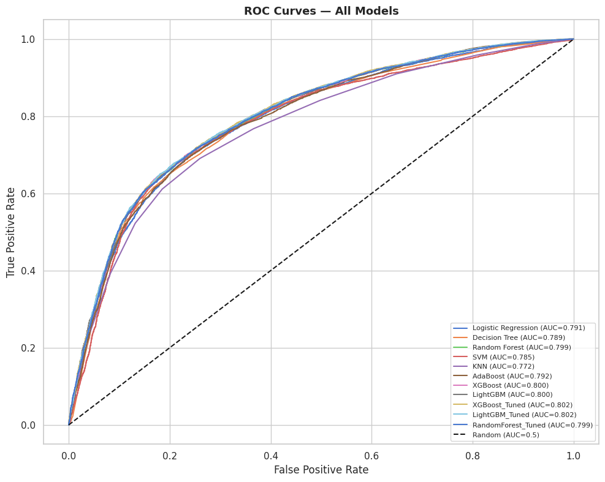
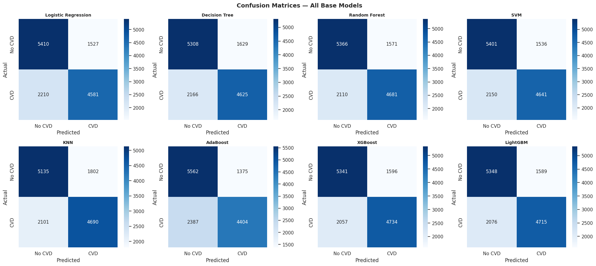
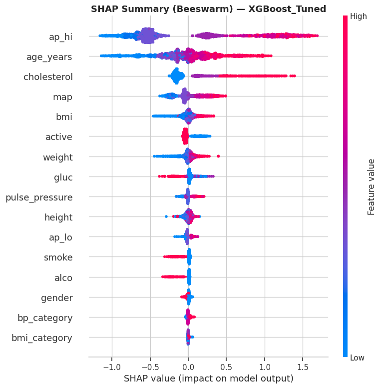
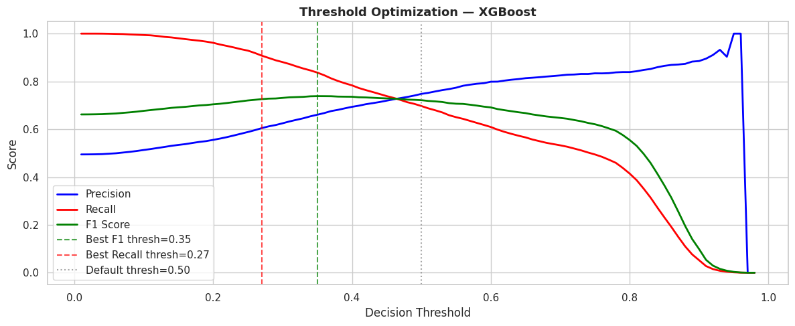
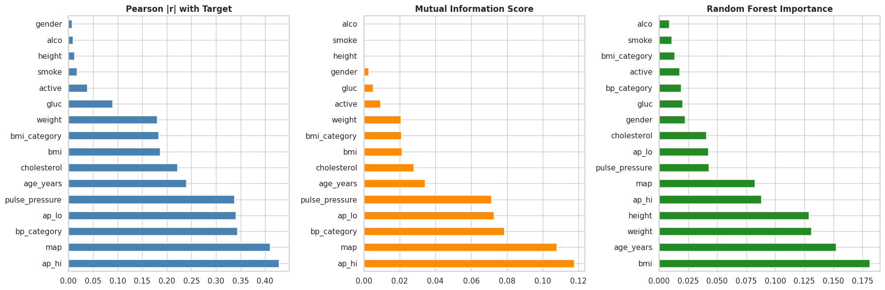
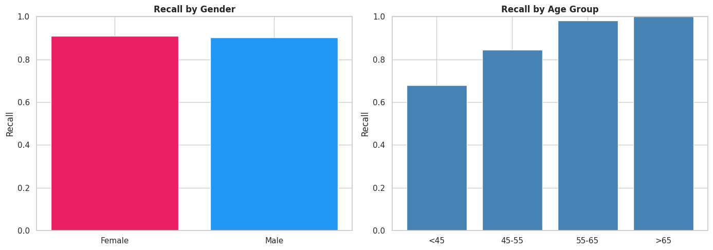

<div align="center">

# 🫀 CardioDecision-ML

### Machine Learning–Based Medical Decision Support System for Cardiovascular Disease Diagnosis

*An interpretable, fairness-audited pipeline that predicts cardiovascular-disease (CVD) risk from routine clinical data — paired with an interactive Next.js analytics dashboard.*

[](https://nextjs.org/)
[](https://react.dev/)
[](https://www.typescriptlang.org/)
[](https://tailwindcss.com/)
[](#-key-results)
[-blue)](#-license)

**[▶ Live Dashboard](https://cardiodecision-ml.vercel.app)** · **[🎬 Demo Video](https://github.com/hamzaaouni/CardioDecision-ML/raw/main/public/demo.mp4)** · **[📄 Thesis (PDF)](https://github.com/hamzaaouni/pfe/blob/main/rapport/Memoire_PFE_AOUNI_Hamza.pdf)** · **[📈 Results](#-results)**

</div>

> ⚠️ **Replace the Live Dashboard link** with your real Vercel URL after the first deploy (see [Deployment](#️-deployment-vercel)).

---

## Abstract

Cardiovascular diseases are the leading cause of death worldwide (~17.9 million deaths/year). **CardioDecision-ML** is an end-to-end machine-learning decision-support system that predicts CVD risk from 11 routinely collected clinical variables. Starting from the public **Kaggle Cardiovascular Disease** dataset (70,000 patients), the project benchmarks **eight** algorithms, tunes the strongest with **Optuna**, and selects an **XGBoost** model reaching a **ROC-AUC of 0.802**. The decision threshold is optimised for the clinical priority of *not missing sick patients*, raising recall to **90.8 %**. Every prediction is made transparent with **SHAP** (global, local, and counterfactual explanations) and the model is **audited for fairness** across sex and age groups. This repository hosts the **interactive Next.js dashboard** that presents the data, the pipeline, and the findings.

---

## 🔑 Key Results

| Metric | Value |
| :--- | :--- |
| **Best model** | XGBoost (Optuna-tuned, 50 trials) |
| **ROC-AUC** | **0.802** &nbsp;(95 % CI 0.795 – 0.810) |
| **Accuracy** | 73.3 % |
| **Recall** | 69.7 % @ default 0.50 → **90.8 % @ operating threshold 0.27** |
| **Precision** @ 0.27 | 60.5 % |
| **PR-AUC / MCC** | 0.786 / 0.466 |
| **Fairness** (sex) | Demographic-Parity Diff. **0.006**, Equalized-Odds Diff. **0.020** (both ≪ 0.05) |
| **Statistical tests** | Bootstrap 95 % CI · DeLong · McNemar |
| **Top predictors (SHAP)** | systolic BP · age · cholesterol · mean arterial pressure · BMI |

> Numbers correspond to the deployed `XGBoost_Tuned` model evaluated on a held-out test set of 13,728 patients.

---

## 🎬 Interactive Demo — three example patients

The companion clinical tool turns raw inputs into a calibrated risk score with a per-patient SHAP explanation. The three profiles below are **real model outputs** (verified against the deployed model), spanning the three risk bands:

| Profile | Age / Sex | Blood pressure | Cholesterol | Glucose | Smoker | Active | BMI | **Predicted risk** | Band |
| :--- | :--- | :--- | :--- | :--- | :---: | :---: | :--- | :---: | :---: |
| Patient A | 35 / F | 110 / 70 | Normal | Normal | No | Yes | 21.3 | **7.1 %** | 🟢 **LOW** |
| Patient B | 54 / M | 138 / 88 | Above normal | Above normal | No | Yes | 29.1 | **64.5 %** | 🟡 **MODERATE** |
| Patient C | 62 / M | 165 / 100 | High | High | Yes | No | 32.9 | **81.1 %** | 🔴 **HIGH** |

*Risk bands: 🟢 LOW < 30 % · 🟡 MODERATE 30–65 % · 🔴 HIGH ≥ 65 %. Cholesterol/glucose are ordinal (Normal / Above normal / High).*

▶ **Watch the full walkthrough:** [`demo.mp4`](https://github.com/hamzaaouni/CardioDecision-ML/raw/main/public/demo.mp4) *(also served at `/demo.mp4` on the live site once deployed).*

---

## 📈 Results

<table>
  <tr>
    <td width="50%"><p align="center"><em>ROC curves — model discrimination</em></p></td>
    <td width="50%"><p align="center"><em>Confusion matrix at thresholds 0.50 and 0.27</em></p></td>
  </tr>
  <tr>
    <td width="50%"><p align="center"><em>Global explainability — SHAP beeswarm</em></p></td>
    <td width="50%"><p align="center"><em>Recall/precision vs. decision threshold</em></p></td>
  </tr>
  <tr>
    <td width="50%"><p align="center"><em>Feature importance across five methods</em></p></td>
    <td width="50%"><p align="center"><em>Fairness audit by demographic subgroup</em></p></td>
  </tr>
</table>

---

## 🖥️ The Dashboard

A single-page, animated analytics dashboard built with Next.js. Sections:

1. **Overview metrics** — dataset size, features, class balance
2. **Distributions** — age, target classes, clinical markers, lifestyle factors
3. **Feature dictionary** — every variable with clinical meaning
4. **Feature importance** — ranked predictors
5. **ML pipeline** — the full development workflow
6. **Preprocessing notes** — cleaning, feature engineering, balancing

> 📌 **Dashboard screenshots:** add UI captures from your live Vercel page into `docs/figures/` and embed them here. They weren't auto-captured because this build environment is offline (the dashboard's Google web-fonts can't be fetched to render it here). Once the site is deployed, screenshots take seconds to grab from the live page.

---

## 🧪 Methodology — ML Pipeline

```
Raw data (Kaggle CVD, 70k)
   └─▶ Preprocessing      outlier removal · feature engineering (BMI, pulse pressure, MAP, categories) · scaling
   └─▶ Train/test split   stratified 80/20 · SMOTE on the training set only (after the split)
   └─▶ Benchmarking       8 algorithms: LogReg · DecisionTree · RandomForest · SVM · KNN · AdaBoost · XGBoost · LightGBM
   └─▶ Tuning             Optuna Bayesian search (XGBoost, LightGBM, RandomForest)
   └─▶ Evaluation         ROC/PR-AUC · recall (primary) · MCC · CV · McNemar · DeLong · bootstrap CI
   └─▶ Explainability     SHAP global + local + counterfactual · fairness audit (Fairlearn)
   └─▶ Threshold + deploy operating threshold 0.27 · Streamlit clinical tool + this dashboard
```

## 📦 Dataset

- **Source:** [Kaggle — Cardiovascular Disease dataset](https://www.kaggle.com/datasets/sulianova/cardiovascular-disease-dataset)
- **Size:** 70,000 patients → **68,637** after clinically guided outlier removal
- **Features:** 11 clinical variables → **16** after feature engineering
- **Target:** `cardio` (binary), naturally balanced ≈ 50 / 50

## 🧰 Tech Stack

`Next.js 16` · `React 19` · `TypeScript` · `Tailwind CSS v4` · `Recharts` · `Framer Motion` · `Lucide Icons`
*(ML side: Python · scikit-learn · XGBoost · LightGBM · Optuna · SHAP · Fairlearn · Streamlit)*

## 🚀 Run Locally

> Requires **Node.js 20+**. The repo uses a `pnpm` lockfile (`pnpm` recommended), but `npm` works too.

```bash
# with pnpm (recommended)
corepack enable
pnpm install
pnpm dev          # http://localhost:3000

# or with npm
npm install
npm run dev
```

Production build:

```bash
pnpm build && pnpm start    # (or: npm run build && npm start)
```

## ☁️ Deployment (Vercel)

This is a standard Next.js app — **no environment variables required**.

1. Push this repo to GitHub (done).
2. Go to **[vercel.com/new](https://vercel.com/new)** and **Import** `hamzaaouni/CardioDecision-ML`.
3. Vercel auto-detects Next.js — keep the defaults and click **Deploy**.
4. Copy the resulting URL (e.g. `https://cardiodecision-ml.vercel.app`) and paste it into the **Live Dashboard** link at the top of this README.

Or from the CLI:

```bash
npm i -g vercel
vercel          # preview
vercel --prod   # production
```

## 🗂️ Project Structure

```text
src/
  app/            layout.tsx · page.tsx · globals.css
  components/     dashboard-header · overview-metrics · distribution-charts ·
                  feature-dictionary · feature-importance · pipeline ·
                  preprocessing-notes · floating-nav · site-footer · ui/*
  lib/            data.ts (all dashboard content) · utils.ts
docs/figures/     model-result figures used in this README
public/           demo.mp4 (interactive prediction walkthrough)
```

## 👤 Author & Supervision

- **Author:** AOUNI Hamza — Master 2, *Big Data & Artificial Intelligence*
- **Supervisor:** Pr. Jilali ANTARI
- **Co-supervisor:** Pr. Mustapha AMROUCH (University of Agadir)
- **Institution:** Multidisciplinary Faculty of Taroudant, Ibn Zohr University — **PFE 2026**

## 📚 Citation

```bibtex
@mastersthesis{aouni2026cardiodecision,
  title  = {Machine Learning-Based Medical Decision Support System for Cardiovascular Disease Diagnosis},
  author = {AOUNI, Hamza},
  school = {Multidisciplinary Faculty of Taroudant, Ibn Zohr University},
  year   = {2026},
  type   = {Master's thesis (PFE)},
  note   = {Big Data and Artificial Intelligence}
}
```

## 📄 License

Academic project — **PFE 2026**. Released for educational and research purposes.

<div align="center"><sub>Built for cardiovascular decision support · transparent, fair, and reproducible ML.</sub></div>
